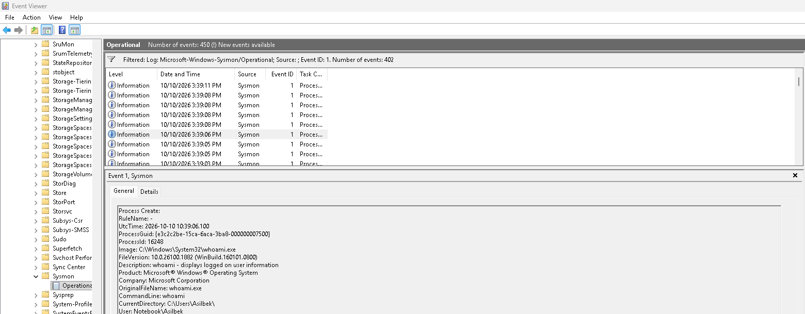
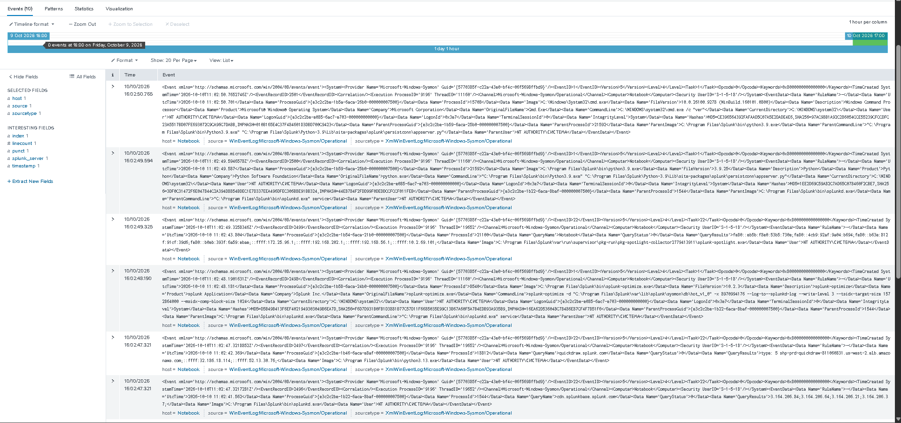
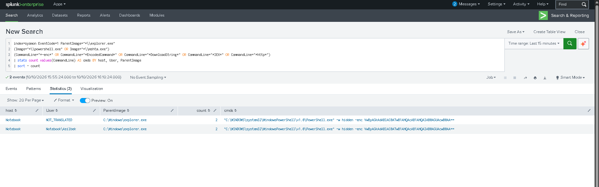
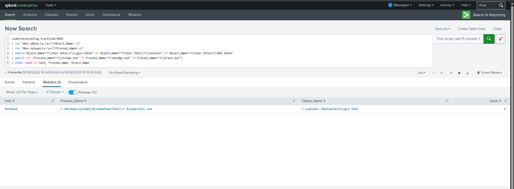
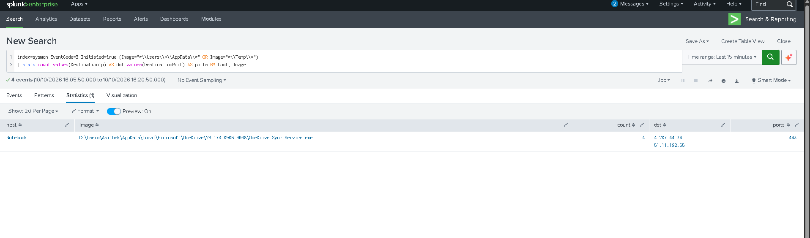
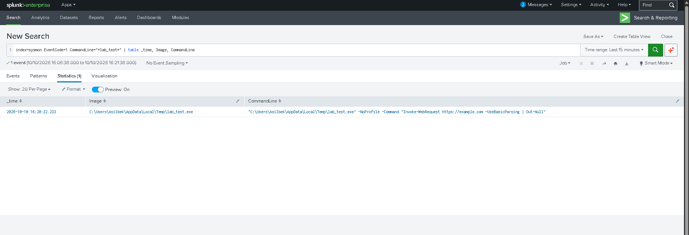
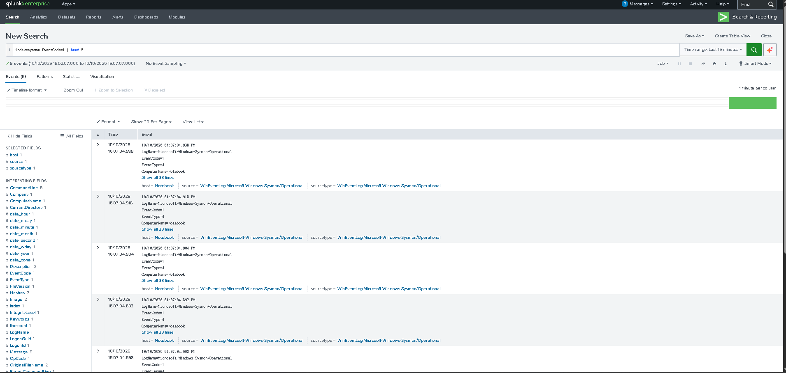

# Week 5 — Threat Hunting Concept (Infostealers / LummaC2)

**State:** hypotheses and queries executed in a lab on a personal Windows host with simulated, harmless activity; results and screenshots are in sections 6–7.

## 1. Context

Our project studies information-stealing malware as a class of threats. In Weeks 2–3 we used the public CISA/FBI advisory **AA25-141B (LummaC2)** as a documented example and imported two reviewed indicators into MISP (event #1). Week 5 moves from *what is known* (intel) to *what we look for in telemetry* (hunt).

**Lab environment:** personal Windows 11 host (Russian locale), simulation only on isolated test files in `C:\Lab`; a system restore point was created before the work. Sysmon v15.22 with the SwiftOnSecurity config, Splunk Enterprise 10.2.3 on the same host. Sysmon, Security and PowerShell logs go to the indexes `sysmon` and `wineventlog`.




## 2. Hunting model

| Model | How it starts | Use in our project |
|---|---|---|
| Intel-driven | IOCs/TTPs from a report | Pivot on the MISP indicators (`mercharena.biz`, the sample SHA256) in DNS/proxy/Sysmon logs |
| **Hypothesis-driven** | Assumption about attacker behavior | **Main approach.** Infostealer IOCs go stale quickly, behavior (TTPs) lasts longer |

Reasoning: the Week 3 domain is ~16 months old and may be repurposed, so we hunt behaviors with ATT&CK mapping and use IOCs only as a secondary pivot.

## 3. Hypotheses

**H1 (execution, ClickFix-style delivery).** *An infostealer was delivered by a fake CAPTCHA/“verify you are human” page that tricked the user into pasting a command into the Run dialog, causing PowerShell or mshta to start from `explorer.exe` with a download/encoded command.*
ATT&CK: T1204 (User Execution), T1059.001 (PowerShell), T1218.005 (Mshta).

**H2 (credential access).** *A non-browser process is reading browser credential/cookie stores (`Login Data`, `Cookies`, `Web Data`) or wallet-extension data.*
ATT&CK: T1555.003 (Credentials from Web Browsers), T1005 (Data from Local System).

**H3 (exfiltration, optional).** *A recently started, unsigned process in a user-writable path makes an outbound connection shortly after H2 activity.*
ATT&CK: T1041 (Exfiltration over C2 Channel).

> Basis: public behavior descriptions in AA25-141B and vendor reporting. These are generic behaviors, not observations from our network. Verify technique IDs on attack.mitre.org before citing.

## 4. Data sources

| Hypothesis | Source | Needed config |
|---|---|---|
| H1 | Sysmon EID 1 (process create), PowerShell 4104, Security 4688 | Command-line logging, Script Block Logging |
| H1 | Registry `HKCU\...\Explorer\RunMRU` (Sysmon EID 13) | Registry rules in Sysmon config |
| H2 | Security 4663 (file read) | Object Access auditing + SACL on `...\User Data\Default\Login Data` etc. (Sysmon does **not** log file reads) |
| H2 | Sysmon EID 11 (file create) | Detects copies of browser DBs to temp |
| H3 | Sysmon EID 3 (network), EID 22 (DNS) | Network/DNS rules enabled |

## 5. Hunt queries

Field names follow ECS (ELK) and Splunk Sysmon add-on conventions; adjust to your index and parsing. Queries actually executed in the lab were Splunk.

### H1 — Run dialog / ClickFix pattern

**ELK (KQL):**
```
event.code : "1" and
process.parent.name : "explorer.exe" and
process.name : ("powershell.exe" or "mshta.exe") and
process.command_line : (*-enc* or *EncodedCommand* or *DownloadString* or *IEX* or *http* or *-w*hidden*)
```

**Splunk (SPL):**
```spl
index=sysmon EventCode=1 ParentImage="*\\explorer.exe"
(Image="*\\powershell.exe" OR Image="*\\mshta.exe")
(CommandLine="*-enc*" OR CommandLine="*EncodedCommand*" OR CommandLine="*DownloadString*" OR CommandLine="*IEX*" OR CommandLine="*http*")
| stats count values(CommandLine) AS cmds BY host, User, ParentImage
| sort - count
```

### H2 — Non-browser access to browser credential stores

**ELK (KQL):**
```
event.code : "4663" and
file.path : (*"\\User Data\\"*"\\Login Data"* or *"\\User Data\\"*"\\Cookies"* or *"\\User Data\\"*"\\Web Data"*) and
not process.name : ("chrome.exe" or "msedge.exe" or "brave.exe" or "opera.exe")
```

**Splunk (SPL), generic version:**
```spl
index=wineventlog EventCode=4663
(Object_Name="*\\User Data\\*\\Login Data" OR Object_Name="*\\User Data\\*\\Cookies" OR Object_Name="*\\User Data\\*\\Web Data")
NOT (Process_Name="*\\chrome.exe" OR Process_Name="*\\msedge.exe" OR Process_Name="*\\brave.exe")
| stats count BY host, Process_Name, Object_Name
```

**Splunk (SPL), version executed in the lab.** On a Russian-locale Windows the fields `Object_Name` and `Process_Name` are not extracted automatically, so they are parsed with `rex`:
```spl
index=wineventlog EventCode=4663
| rex "Имя объекта:\s+(?<Object_Name>.+)"
| rex "Имя процесса:\s+(?<Process_Name>.+)"
| search Object_Name="*\\User Data\\*\\Login Data*" OR Object_Name="*\\User Data\\*\\Cookies*" OR Object_Name="*\\User Data\\*\\Web Data*"
| search NOT (Process_Name="*\\chrome.exe" OR Process_Name="*\\msedge.exe" OR Process_Name="*\\brave.exe")
| stats count BY host, Process_Name, Object_Name
```

### H3 — Pivot to network (run after H2 hit)

```spl
index=sysmon EventCode=3 Initiated=true Image IN ("*\\Users\\*\\AppData\\*", "*\\Temp\\*")
| stats count values(DestinationIp) AS dst values(DestinationPort) AS ports BY host, Image
```

### Intel pivot (secondary): MISP indicators

```
dns.question.name : "mercharena.biz"
```
```spl
index=sysmon EventCode=22 QueryName="mercharena.biz"
```

## 6. Safe simulation to generate test data

Do **not** run real malware and do **not** use real browser profiles or credentials.

- H1: run a harmless command from the Run dialog that mimics the pattern, e.g. `powershell -w hidden -enc <base64 of "Write-Output test">`.
- H2: create a **lab-only dummy file** at a fake `...\User Data\Default\Login Data` path (random bytes, no real data), then read/copy it with a non-browser process such as a PowerShell one-liner. Enable the SACL first so 4663 fires.
- Optionally use an Atomic Red Team T1555.003 test only in an isolated VM and after checking what it does (Week 9 covers Atomic Red Team in depth).

**What was executed** (Windows PowerShell 5.1, personal host, no VM snapshot; a restore point `before-lab` was used instead):

- H1: Win+R, `powershell -w hidden -enc VwByAGkAdABlAC0ATwB1AHQAcAB1AHQAIAB0AGUAcwB0AA==` (decodes to `Write-Output test`).
- H2: dummy file `C:\Lab\User Data\Default\Login Data` (1024 random bytes). Audit rule (Everyone, ReadData, Success) set on the folder and directly on the file. Read with `Get-Content "C:\Lab\User Data\Default\Login Data" -Encoding Byte -TotalCount 100`. First read: 11:14:37 UTC.
- H3: copied `powershell.exe` to `%TEMP%\lab_test.exe` and ran `Invoke-WebRequest https://example.com`. Time: 11:20:32 UTC.


## 7. Findings

| Hypothesis | Hits | True positive (simulated) | False positives | Notes |
|---|---|---|---|---|
| H1 | 2 events (1 launch) | 1 | 0 | Sysmon logged the same command twice, the second with `User = NOT_TRANSLATED` |
| H2 | 4 | 4 (`powershell.exe` read the dummy Login Data) | 0 | Fields extracted with `rex` because of the Russian locale |
| H3 | 1 process, 4 connections to port 443 | 0 | 1 (`OneDrive.Sync.Service.exe` from AppData) | Simulated `lab_test.exe` start is visible in EID 1, but its network connection was not logged by Sysmon |

Screenshots:







## 8. Tuning and conclusion

- Exclusions: for H3 an exclusion `NOT Image="*\\OneDrive.Sync.Service.exe"` is recommended for the legitimate sync client (not applied in this run). For H2 in a real environment, exclusions for backup/AV/sync tools are needed.
- H1 confirmed in the lab. H2 confirmed in the lab. H3 not confirmed: no true positive, one false positive (OneDrive).
- Problems and fixes:
  - Russian locale: `auditpol` needs subcategory GUIDs instead of names, and 4663 fields need `rex`.
  - The audit rule had to be set directly on the file, not only on the folder.
  - Splunk service was switched to `LocalSystem` to read Security and Sysmon logs.
  - `renderXml = false` for the Sysmon input so that fields (`Image`, `CommandLine`, `ParentImage`) are parsed.
- Limits: a lab simulation shows the query works, not that it finds real infostealers. Browser-file auditing is noisy, and encrypted browser data (app-bound encryption in newer Chromium) changes what stealers do. The SwiftOnSecurity config logs Sysmon EID 3 selectively, so the network connection of `lab_test.exe` was not recorded; H3 needs a NetworkConnect rule for Temp/AppData.
- Next step: convert the best query to a Sigma rule (ties to Week 3 Sigma) and map to ATT&CK Navigator in Week 6.

## 9. References

- CISA/FBI, *#StopRansomware/LummaC2 Malware* advisory AA25-141B
- Microsoft, Threat Hunting Guide
- Phillip Smith, *Practical Threat Hunting*
- MITRE ATT&CK: attack.mitre.org (T1059.001, T1555.003, T1204, T1041)
- Course AI-use statement: see main README

## 10. Defense outline (7–8 min)

| Time | Content |
|---|---|
| 0:00–1:00 | Project recap (Weeks 1–3, LummaC2/MISP) and hunting models |
| 1:00–2:00 | Hypotheses H1–H3 and data sources |
| 2:00–5:00 | Live demo or screenshots: queries, simulated activity, results |
| 5:00–6:30 | Findings, false positives, tuning |
| 6:30–7:30 | Conclusion, GitHub commit history, Week 6 plan |

## Suggested commits

```
week5: add hypotheses and data sources
week5: add Splunk/ELK queries
week5: lab setup + simulation evidence
week5: findings, tuning, conclusion
```
