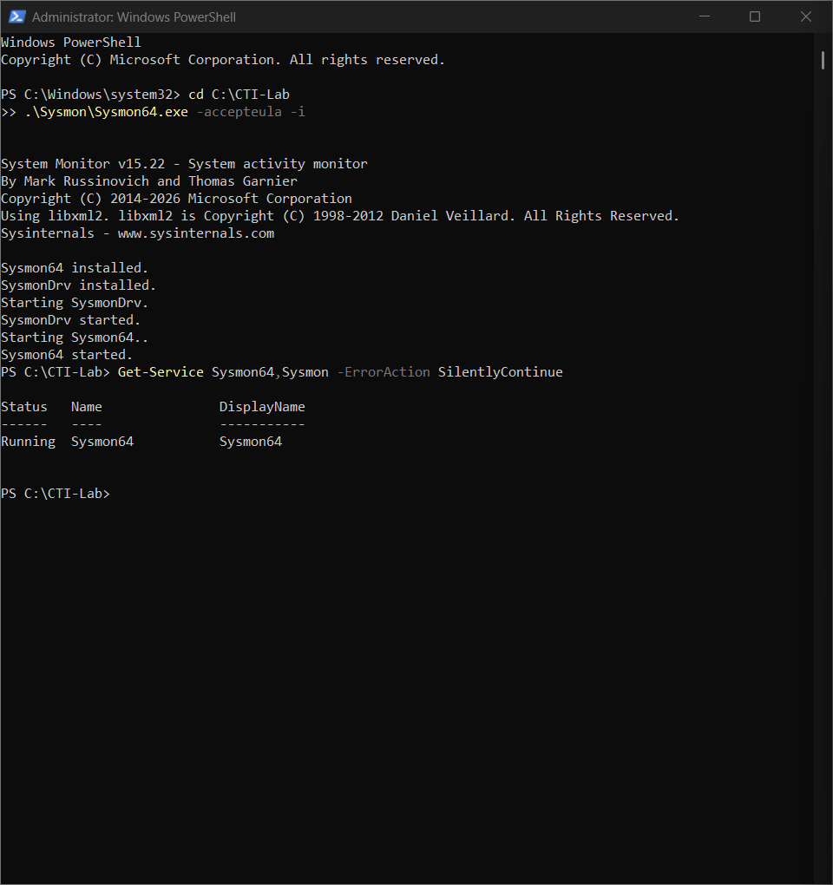
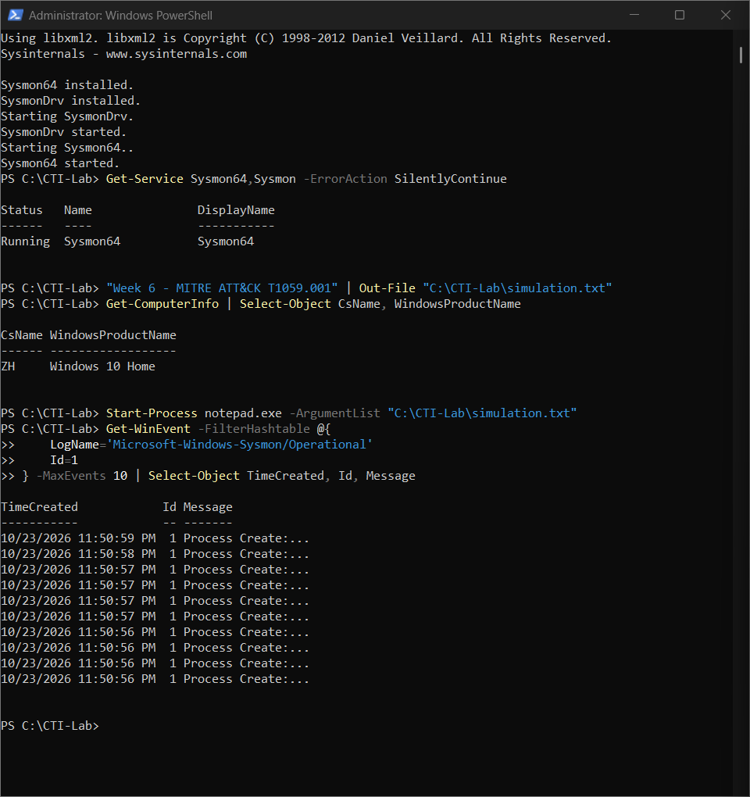
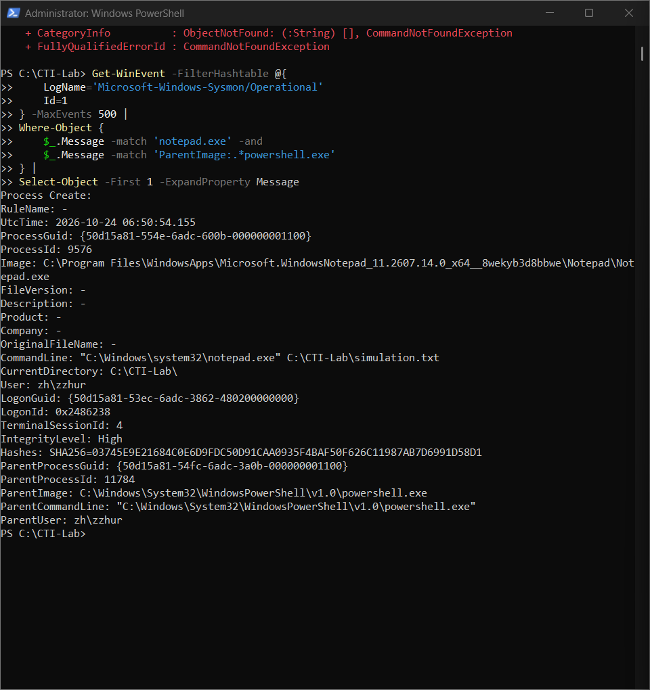

# Week 6 — MITRE ATT&CK Framework

## Project: Infostealer Threat Intelligence

### 1. Objective

The objective of this week's work was to study a MITRE ATT&CK technique, perform a controlled simulation, collect host telemetry, and map the observed behavior to the framework. Our broader project examines infostealer activity, including the Lumma Stealer / ClickFix scenario. This lab does not execute Lumma Stealer or reproduce a complete infection chain.

### 2. Selected Technique

- **Framework:** MITRE ATT&CK Enterprise
- **Technique:** T1059 — Command and Scripting Interpreter
- **Sub-technique:** T1059.001 — PowerShell
- **Relevant tactic:** Execution (TA0002)
- **Reference:** https://attack.mitre.org/techniques/T1059/001/

PowerShell can be used legitimately for system administration, but adversaries can also abuse it to execute commands or scripts. The simulation demonstrates command execution through PowerShell and the corresponding process creation telemetry, not malicious behavior by itself.

### 3. Lab Environment

- **Operating system:** Windows 11
- **Shell:** Windows PowerShell
- **Monitoring tool:** Microsoft Sysinternals Sysmon v15.22
- **Log source:** `Microsoft-Windows-Sysmon/Operational`
- **Event examined:** Sysmon Event ID 1 — Process Create
- **Working directory:** `C:\CTI-Lab`

Sysmon was downloaded, extracted, installed from an elevated PowerShell session, and verified to be running.



### 4. Simulation Procedure

A harmless text file was created and basic host information was queried using PowerShell. Notepad was then launched through PowerShell to open the file.

```powershell
New-Item -ItemType Directory -Path C:\CTI-Lab -Force
"Week 6 - MITRE ATT&CK T1059.001" | Out-File "C:\CTI-Lab\simulation.txt"
Get-ComputerInfo | Select-Object CsName, WindowsProductName
Start-Process notepad.exe -ArgumentList "C:\CTI-Lab\simulation.txt"
```

The commands ran successfully. The host information command reported Windows 10 Home. No malicious payload, credential collection, persistence, or data exfiltration was attempted.



### 5. Evidence Collection and Results

The Sysmon Operational log was queried for process creation events, filtering for Notepad events with PowerShell as the parent process:

```powershell
Get-WinEvent -FilterHashtable @{
    LogName='Microsoft-Windows-Sysmon/Operational'
    Id=1
} -MaxEvents 500 |
Where-Object {
    $_.Message -match 'notepad.exe' -and
    $_.Message -match 'ParentImage:.*powershell.exe'
} |
Select-Object -First 1 -ExpandProperty Message
```

**Observed evidence:**

- **Event type:** Sysmon Event ID 1 — Process Create
- **Image:** Windows Notepad executable
- **ParentImage:** `C:\Windows\System32\WindowsPowerShell\v1.0\powershell.exe`
- **CommandLine:** `"C:\Windows\system32\notepad.exe" C:\CTI-Lab\simulation.txt`
- **ParentCommandLine:** Windows PowerShell executable
- **CurrentDirectory:** `C:\CTI-Lab\`

The event confirms that a PowerShell process launched Notepad with the lab file as an argument. A separate Notepad-to-Notepad event was also observed, so the event with `ParentImage` set to `powershell.exe` was selected as the direct evidence of the original launch.



### 6. MITRE ATT&CK Mapping

| Observed action | ATT&CK tactic | ATT&CK technique | Evidence |
| --- | --- | --- | --- |
| Executing commands in PowerShell | Execution (TA0002) | T1059.001 — PowerShell | PowerShell command execution screenshot |
| Launching Notepad through PowerShell | Execution (TA0002) | T1059.001 — PowerShell | Sysmon Event ID 1 with `ParentImage` = `powershell.exe` |

**Interpretation:** The evidence is consistent with a benign demonstration of PowerShell command execution. The same interpreter can be abused in malicious ClickFix-related execution chains, but this experiment alone does not establish a ClickFix compromise or infostealer infection.

### 7. Detection and Limitations

Sysmon Event ID 1 records process creation details such as executable paths, command lines, and parent-child relationships. These fields can support threat hunting and process-tree reconstruction. However, launching Notepad from PowerShell is normal administrative or user behavior; it is not sufficient to raise a high-confidence malware alert.

Limitations of this lab:

- No real infostealer sample was run.
- No phishing or ClickFix lure was reproduced.
- No network activity, persistence, credential theft, or exfiltration was tested.
- The analysis was performed in Windows PowerShell and Sysmon, without SIEM correlation.
- Only a small number of process events were examined; detection accuracy and false-positive rates were not measured.

### 8. Conclusion

Week 6 demonstrated MITRE ATT&CK T1059.001 in a controlled Windows environment. PowerShell executed benign commands and started Notepad, while Sysmon Event ID 1 captured the relevant parent-child process relationship. The exercise shows how ATT&CK can be used to describe observed endpoint behavior and prepare for later detection engineering. In Week 7, this telemetry can be used as a starting point for evaluating a MITRE CAR analytic in a SIEM.

### References

1. MITRE ATT&CK, PowerShell (T1059.001): https://attack.mitre.org/techniques/T1059/001/
2. MITRE ATT&CK, Execution (TA0002): https://attack.mitre.org/tactics/TA0002/
3. Microsoft Sysinternals, Sysmon: https://learn.microsoft.com/en-us/sysinternals/downloads/sysmon
