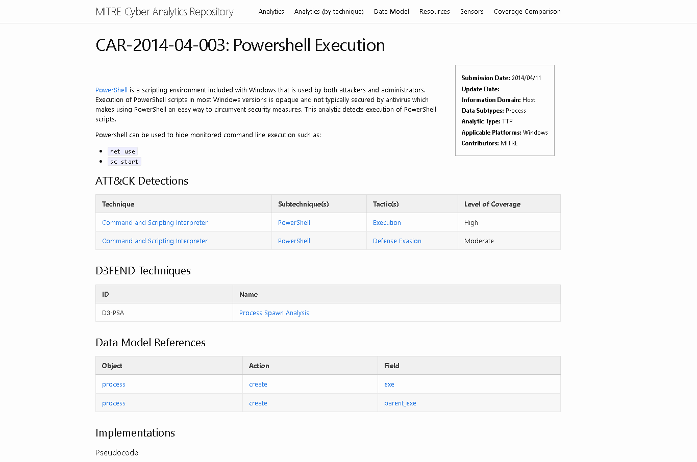
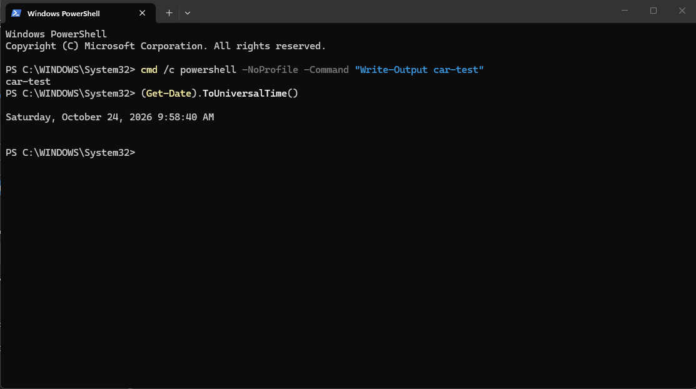
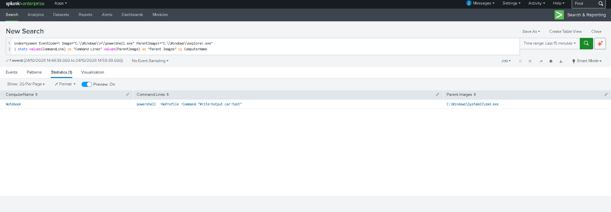
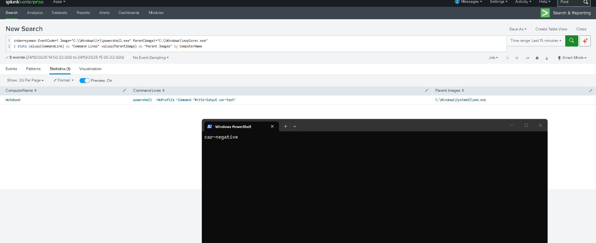
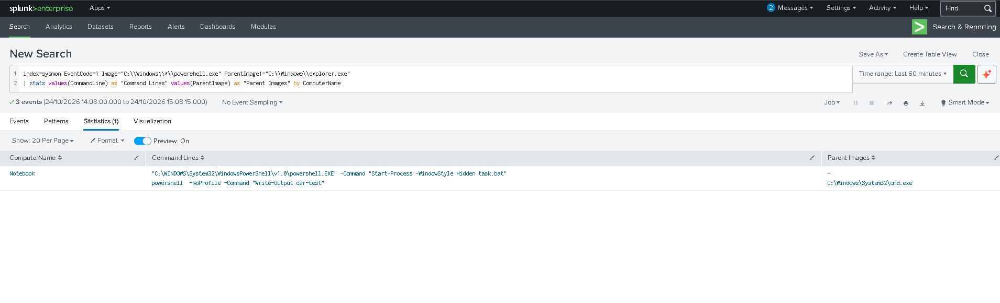
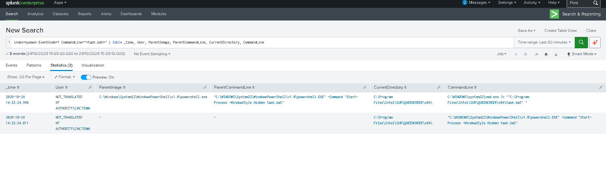

# Week 7 — Using MITRE CAR (Cyber Analytics Repository)

**State:** one CAR analytic selected, implemented in Splunk on the Week 5 lab, tested with a positive and a negative case, mapped to ATT&CK. Evidence is in sections 4–6.

## 1. Context

In Week 5 we hunted infostealer behavior with our own hypotheses (H1–H3). Week 7 uses a public, ready-made source of detection logic: **MITRE CAR** (car.mitre.org). We take one CAR analytic, implement it in the same Splunk lab (Sysmon logs in index `sysmon`) and map it to ATT&CK.

**Lab:** personal Windows 11 host, Sysmon v15.22 (SwiftOnSecurity config), Splunk Enterprise 10.2.3 (see Week 5 report for setup).

## 2. Analytics vs detections

| | Analytic (CAR) | Detection (our Splunk query) |
|---|---|---|
| What it is | Idea and logic: hypothesis, required data, pseudocode | Concrete implementation for our tool and data |
| Tool dependence | Not tied to a product (pseudocode, plus examples for Splunk, EQL, etc.) | Tied to Splunk field names, index, log source |
| Output | Explanation of why the behavior is suspicious | Real events in our environment |
| Needs tuning | No | Yes (our false positives, exclusions) |

CAR says about itself that it provides validated, well-explained analytics with their theory and rationale, while the choice of how to defend remains with the organization. So CAR analytics are a starting point, not a finished detection.

## 3. Selected analytic: CAR-2014-04-003 "Powershell Execution"

Source: https://car.mitre.org/analytics/CAR-2014-04-003/

| Property | Value |
|---|---|
| Information domain / data | Host / Process (create) |
| Type / platform | TTP / Windows |
| Logic | PowerShell that was not launched interactively: `exe == powershell.exe AND parent_exe != explorer.exe` |
| Data model fields | process create: `exe`, `parent_exe` |
| D3FEND | D3-PSA (Process Spawn Analysis) |

Why this analytic: it uses the same data we already collect (Sysmon event 1) and continues our H1 (PowerShell and execution).



## 4. Implementation in Splunk

CAR provides a "Splunk, Sysmon native" version. We used it with our index name:

```spl
index=sysmon EventCode=1 Image="C:\\Windows\\*\\powershell.exe" ParentImage!="C:\\Windows\\explorer.exe"
| stats values(CommandLine) as "Command Lines" values(ParentImage) as "Parent Images" by ComputerName
```

Fields `Image`, `ParentImage`, `CommandLine` are parsed automatically because the Sysmon input uses `renderXml = false` (Week 5).

## 5. Test and results

**Positive test** (harmless, PowerShell started by `cmd.exe`, not by `explorer.exe`), executed at 09:58:40 UTC on 2026-10-24:

```
cmd /c powershell -NoProfile -Command "Write-Output car-test"
```



Result: the analytic returned the test command with parent `C:\Windows\System32\cmd.exe`.



**Negative test** (PowerShell started from the Run dialog, parent `explorer.exe`):

```
powershell -NoProfile -Command "Write-Output car-negative; Start-Sleep 5"
```

Result: no row with `car-negative` (the PowerShell window with `car-negative` is visible on the screenshot, but the analytic does not report it). This is the expected behavior of the analytic.



## 6. False positives

Query over the last 60 minutes returned, besides our test, one more PowerShell launch:

```
powershell.EXE -Command "Start-Process -WindowStyle Hidden task.bat"
```



Details (search by `task.bat`):

- User: `NT AUTHORITY\SYSTEM` (shown as `NOT_TRANSLATED` because of the Russian locale).
- Working directory: `C:\Program Files\Intel\SUR\QUEENCREEK\x64\`.
- The same chain appears as PowerShell (parent missing, the parent process had already exited) and as `cmd.exe /c ... task.bat` started by PowerShell.



Assessment: most likely a legitimate Intel background component (System Usage Report), based on the install path under Program Files and the SYSTEM context. It was not verified further than that. It is still a good example of why the analytic is noisy: hidden, scripted PowerShell launched by system software looks the same as suspicious activity.

| Case | Hits | True positive | False positive |
|---|---|---|---|
| Test `car-test` (parent `cmd.exe`) | 1 | 1 | 0 |
| Test `car-negative` (parent `explorer.exe`) | 0 | n/a | 0 |
| Intel `task.bat` launcher | 1 | 0 | 1 |

## 7. Mapping to ATT&CK

| Analytic | Technique | Sub-technique | Tactic | Coverage (per CAR) |
|---|---|---|---|---|
| CAR-2014-04-003 | T1059 Command and Scripting Interpreter | T1059.001 PowerShell | Execution (TA0002) | High |
| CAR-2014-04-003 | T1059 Command and Scripting Interpreter | T1059.001 PowerShell | Defense Evasion (TA0005) | Moderate |

Link to Week 5: H1 maps to T1204 (User Execution), T1059.001 and T1218.005. The CAR analytic shares T1059.001 with H1 but looks at the opposite case: CAR excludes `explorer.exe` as parent, while H1 looks for PowerShell started *from* `explorer.exe` (ClickFix pattern). Together they cover both launch paths.

> Verify technique IDs on attack.mitre.org before citing.

## 8. Tuning, limits, conclusion

- Tuning for our environment: exclude the known Intel launcher by exact command line, `User = SYSTEM` and directory `C:\Program Files\Intel\SUR\`. Exclusions by path alone are weak, an attacker can imitate a path, so the exclusion should combine several fields.
- Limit 1: the analytic does not see the ClickFix pattern (parent `explorer.exe`), which is exactly H1 from Week 5.
- Limit 2: the pattern `C:\Windows\*\powershell.exe` does not match renamed copies, for example our `lab_test.exe` from Week 5 (a copy of `powershell.exe` in `%TEMP%`).
- Limit 3: noisy on system and admin scripts; events with an unknown parent (`-`) appear when the parent has already exited.
- Next step: add command-line conditions (`-enc`, `-w hidden`) to reduce noise, or convert the query into a Sigma rule and add the technique to the ATT&CK Navigator layer.
- Conclusion: a CAR analytic gives a clear, explained logic that we implemented in Splunk in a few minutes. It worked on the positive test and did not trigger on the negative one. The false positive from the Intel component shows that an analytic still needs tuning to become a usable detection.

## 9. References

- MITRE CAR: https://car.mitre.org/ (analytic CAR-2014-04-003)
- MITRE ATT&CK: attack.mitre.org (T1059.001)
- MITRE D3FEND: D3-PSA Process Spawn Analysis
- Week 5 report: threat hunting concept (H1–H3, Splunk lab)
- Course AI-use statement: see main README
