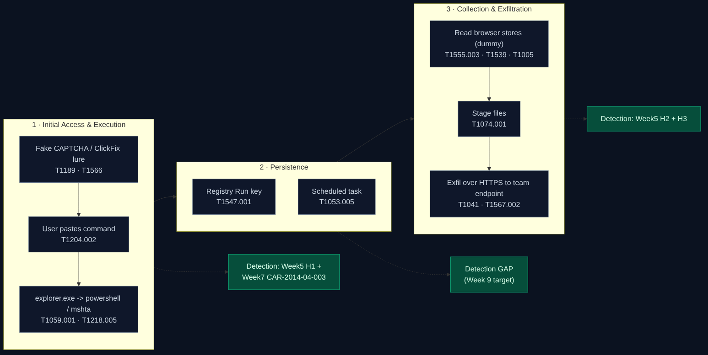
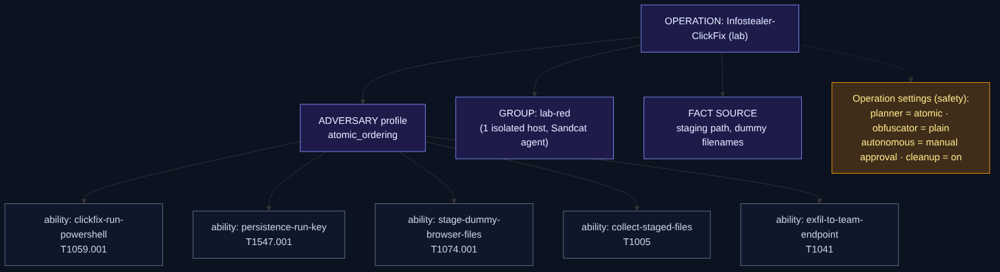

# Week 8 - Creating a Plan to Emulate an Attacker's Action

## Project: Infostealer Threat Intelligence

**State:** adversary emulation plan written at the planning/documentation level for
the infostealer scenario we have tracked since Week 2 (Lumma/Amadey "Fake CAPTCHA"
ClickFix, Kaspersky Securelist 2024-10-29; CISA/FBI AA25-141B LummaC2). The plan is
documented with MITRE ATT&CK techniques and expressed as a CALDERA-style adversary
profile. **No emulation was executed**: this week delivers the *plan*, consistent
with the course task ("create a plan to emulate an attacker's action") and with our
project's standing rule of no malware execution and no action against the university
network. Where the plan would need execution, we describe what *would* be run in an
isolated lab and how it would be detected, rather than running it.

## 1. Objective and relation to the course

The Week 8 task is to build a **simple adversary emulation plan** covering three
stages — initial access → persistence → data exfiltration — and to document it using
ATT&CK techniques, with MITRE CALDERA documentation as recommended reading.

This closes a loop in the course. Weeks 1–4 established *what the threat is* (CTI,
sources, Cyber Kill Chain). Weeks 5–7 moved to *how we detect it* (hypothesis-driven
hunting, an ATT&CK technique simulation, a MITRE CAR analytic in Splunk). Week 8
reverses the viewpoint: we now describe the **attacker's plan** for the same
infostealer behavior, so that in Weeks 9–10 (Atomic Red Team, APT techniques) the
individual techniques can be executed and tested against the detections we already
built.

## 2. Adversary emulation vs. related activities

Adversary emulation is intelligence-driven: it reproduces the specific, documented
TTPs of a chosen threat so that defenders can measure whether they detect them. It is
not the same as a penetration test (find any exploitable weakness) or an open-ended
red team (achieve an objective by any means).

| Activity | Driven by | Goal | Our use |
|---|---|---|---|
| Vulnerability scan | Tool signatures | List known CVEs | Not used |
| Penetration test | Exploitable weaknesses | Prove access is possible | Not used |
| Red teaming | An objective + stealth | Test people/process/tech end to end | Context only |
| **Adversary emulation** | **A specific actor's documented TTPs** | **Measure detection of those TTPs** | **This plan** |

Because our evidence base (Weeks 2–4) is a documented infostealer campaign with an
ATT&CK mapping, **emulation** is the correct framing: we emulate the *behaviors*
described in public reporting, not a specific binary, and we judge success by whether
our Week 5–7 detections fire.

> Sources for this framing: MITRE Engenuity Center for Threat-Informed Defense
> (Adversary Emulation Library, "Getting Started" plan format) and standard
> red-teaming references. See §9.

## 3. Scope, authorization and safety (read before anything is run)

This is a university project. The plan is written so that **every stage could be
safely demonstrated later in an isolated lab**, and so that it can never be mistaken
for an operation against a real target.

- **Authorization:** emulation would only ever run on the personal, isolated lab host
  already used in Weeks 5–7 (Windows 11 VM/host, Sysmon + Splunk), owned by a team
  member. No university system, account or network is in scope.
- **No live malware:** we do not run Lumma or any real stealer, and we do not steal
  real credentials, cookies or wallet data. Where a stage requires an "action", it is
  replaced by a **harmless proxy** that produces the same ATT&CK telemetry (e.g. a
  benign PowerShell command, a copy of a *dummy* file we created, an HTTPS POST of a
  text file we control to a server we control).
- **Containment:** restore point / snapshot before work; no outbound connection to any
  third-party victim; exfiltration "destination" is a local or team-owned endpoint.
- **This document itself is inert:** it contains ATT&CK technique IDs and a CALDERA
  adversary structure, not a working payload, loader, or obfuscated command.

These are the same constraints we stated in Weeks 3, 5 and 6.

## 4. The emulation plan

The plan follows the Lumma/ClickFix chain documented in Week 4, compressed into the
three stages the task requires. Each stage lists the emulated action (the *behavior*),
the harmless lab proxy we would use to produce it, the ATT&CK mapping, and the
detection we already have.



### Stage 1 — Initial access & execution

**Emulated behavior.** A user is tricked by a fake "verify you are human" (ClickFix)
page into copying a command into the Windows Run dialog; `explorer.exe` then spawns
`powershell.exe`/`mshta.exe` with a download-and-run command. This is the delivery
behavior from AA25-141B and the Kaspersky report.

**Harmless lab proxy.** From the Run dialog, launch PowerShell with a benign command
(e.g. write a marker string to `C:\Lab\clickfix_marker.txt`). No download of real
malware; if a fetch step is demonstrated, it retrieves a text file from a team-owned
server, not a payload.

| ATT&CK | Technique | Why |
|---|---|---|
| T1189 | Drive-by Compromise | Fake CAPTCHA / ClickFix lure page |
| T1566 | Phishing (context) | Delivery of the lure |
| T1204.002 | User Execution: Malicious File/paste | User pastes the command |
| T1059.001 | Command and Scripting Interpreter: PowerShell | `explorer.exe` → `powershell.exe` |
| T1218.005 | System Binary Proxy Execution: Mshta | Alternative `mshta` launch path |

**Detection we already have.** Week 5 hypothesis **H1** (Sysmon EID 1, parent
`explorer.exe`, child `powershell.exe`/`mshta.exe` with `-enc`/`DownloadString`/`http`)
and the Week 7 CAR analytic CAR-2014-04-003 (the complementary "PowerShell not spawned
by explorer.exe" case). Together they cover both launch paths.

### Stage 2 — Persistence

**Emulated behavior.** Many commodity infostealers are "smash-and-grab" and run once
with **no** persistence — an honest emulation must say so. However, loaders and some
stealer campaigns establish persistence to re-run collection or survive reboot. We
emulate the most commonly reported, low-risk options.

**Harmless lab proxy.** Create a Run key / scheduled task that points at a **benign**
script we wrote (e.g. one that writes a timestamp to a log). The point is to generate
the persistence *telemetry*, not to persist malware.

| ATT&CK | Technique | Lab proxy |
|---|---|---|
| T1547.001 | Boot/Logon Autostart: Registry Run Keys | Add `HKCU\...\Run\LabMarker` → benign script |
| T1053.005 | Scheduled Task/Job: Scheduled Task | Create a task running a benign script at logon |
| T1176 | Browser Extension (reported for some stealers) | Described only; not executed |

**Detection to add (Week 9 target).** Sysmon EID 13 (registry) for `...\Run` writes;
EID 1 for `schtasks.exe`/`reg.exe`; Security 4698 (scheduled task created). This is a
gap in our current coverage and is written up as a next step (§8), honest about the
fact that Week 5–7 did not yet hunt persistence.

### Stage 3 — Data collection & exfiltration

**Emulated behavior.** The stealer reads browser credential/cookie/wallet stores and
transfers the collected data to attacker infrastructure over an existing channel.

**Harmless lab proxy.** Instead of touching real browser databases, we create *dummy*
files named like the real artifacts (a fake `Login Data` SQLite file we populate with
obviously fake rows) inside a lab directory, then "collect" and send **those** files —
an HTTPS POST of a small text archive to a **team-owned** endpoint. Nothing real
leaves the host; the behavior (read staged files → single outbound POST) is what the
detection sees.

| ATT&CK | Technique | Why |
|---|---|---|
| T1555.003 | Credentials from Web Browsers | Read of (dummy) `Login Data` |
| T1539 | Steal Web Session Cookie | Read of (dummy) `Cookies` |
| T1005 | Data from Local System | Collect staged files |
| T1074.001 | Local Data Staging | Copy into a temp staging folder |
| T1041 | Exfiltration Over C2 Channel | POST to team-owned endpoint |
| T1567.002 | Exfiltration to Cloud Storage (alt.) | Alternative documented route |

**Detection we already have / plan.** Week 5 hypothesis **H2** (non-browser process
reading `...\User Data\...\Login Data`/`Cookies`/`Web Data`, Security 4663 + SACL) and
**H3** (recently started unsigned process in a user-writable path making an outbound
connection shortly after H2; Sysmon EID 3/22). Stage 3 is exactly what H2+H3 were
written to catch.

## 5. Full ATT&CK layer for the plan

The complete technique list, in attack order, suitable for import as an ATT&CK
Navigator layer (Debrief/Compass can generate this automatically from a CALDERA run —
see §6):

```
Initial Access / Execution : T1189, T1566, T1204.002, T1059.001, T1218.005
Persistence                : T1547.001, T1053.005, T1176
Collection                 : T1555.003, T1539, T1005, T1074.001
Exfiltration               : T1041, T1567.002
```

> Verify every technique ID on attack.mitre.org before citing — we keep this note in
> every report because ATT&CK IDs and sub-technique numbers change between versions.

## 6. Documenting the plan as a CALDERA adversary (recommended reading)

MITRE **CALDERA** is an open-source adversary-emulation platform built on ATT&CK. The
recommended reading for this week is its documentation
(<https://caldera.readthedocs.io>). We summarize the terminology and then express our
plan in CALDERA's model, so the plan is reproducible on the platform in a lab —
without running it here.

### 6.1 CALDERA terminology (from the docs)

| Term | Meaning |
|---|---|
| **Agent** | A program that checks in to the CALDERA server for instructions, identified by a unique *paw*. Default agent: **Sandcat** (GoLang, HTTP/GIST/DNS contacts); others: **Manx** (TCP reverse shell), **Ragdoll** (Python/HTML). |
| **Group** | Label set at agent install; operations target a group. `blue` group shows on the blue dashboard, everything else on red. |
| **Ability** | One ATT&CK technique implemented as a command for a platform/executor (e.g. Windows/PowerShell), with optional payloads, `requirements` (facts needed first), parsers, and `cleanup`. |
| **Adversary** | A **profile**: an ordered set of abilities representing a threat actor's TTPs (the *atomic ordering*). |
| **Operation** | Running an adversary profile against a group, with a **planner**, a **fact source**, and stealth settings (obfuscators). Produces *links* (one planned command per agent) that join the operation *chain*. |
| **Fact / Fact source** | A named piece of information (e.g. a host, a file path) that abilities consume and parsers produce; rules decide which parsed facts are kept. |
| **Planner** | Decides ability order: **atomic** (adversary's order), **batch** (all at once), **buckets** (grouped by tactic). |
| **Parser / Rule** | A parser extracts facts from command output; fact rules filter which are added for later links. |
| **Plugin** | Extension. Key ones: **Stockpile** (most open-source abilities/adversaries/planners), **Sandcat** (agent), **Training**, **Atomic** (imports Atomic Red Team — our Week 9), **Emu** (CTID emulation plans, e.g. FIN6/APT29), **Debrief** and **Compass** (reports + ATT&CK Navigator layers). |

### 6.2 Our plan expressed as a CALDERA adversary profile

The plan maps cleanly onto CALDERA objects. This is the **design**, written as the
docs describe adversary/ability YAML — it is a specification of our plan, not an
executable payload:



```
Adversary profile: "Infostealer-ClickFix (lab emulation)"
  objective: demonstrate detection of an infostealer chain in the Week 5 lab
  atomic_ordering (ability -> ATT&CK technique):
    1. clickfix-run-powershell        -> T1059.001   (Execution)
    2. persistence-run-key            -> T1547.001   (Persistence)
    3. stage-dummy-browser-files      -> T1074.001   (Collection staging)
    4. collect-staged-files           -> T1005        (Collection)
    5. exfil-to-team-endpoint         -> T1041        (Exfiltration)

Operation settings:
  group:     lab-red (single isolated host)
  planner:   atomic            # run in the order above
  fact source: a small lab fact source (staging path, dummy filenames)
  obfuscator: plain            # no obfuscation — we WANT the telemetry visible
  autonomous: manual approval  # approve each link, so nothing runs unattended
  auto-close / cleanup: on     # abilities remove the benign artifacts afterwards
```

Design choices that keep this a *safe* emulation rather than an attack:

- **`obfuscator: plain`** — the whole point is to generate clean, visible telemetry
  for detection, so we deliberately do *not* hide the commands.
- **`autonomous: manual`** — links are approved one at a time; nothing runs by itself.
- Every ability uses a **benign proxy command** and a **`cleanup`** step, so the host
  returns to its prior state.
- Mapping each ability to a technique lets **Compass/Debrief** emit an ATT&CK Navigator
  layer that we can lay over the Week 5–7 detection coverage to find gaps (persistence,
  §8).

### 6.3 Security note on the tool itself

CALDERA 5.x (latest line, see §9) must be run only in the isolated lab. Note the public
advisory **CVE-2025-27364** (remote code execution affecting CALDERA server
installations): the server should never be exposed to a network outside the lab, and
default credentials in `conf/local.yml` must be changed. We record this because running
an emulation *platform* carelessly is itself a risk.

## 7. Defensive value (blue-team view)

Emulation is only useful if it improves defense. Mapping the plan back to detection:

| Stage | Emulated technique | Detection status |
|---|---|---|
| Initial access | T1059.001 (explorer→PowerShell) | **Covered** — Week 5 H1, Week 7 CAR analytic |
| Persistence | T1547.001 / T1053.005 | **Gap** — not yet hunted (Week 9 task) |
| Collection | T1555.003 / T1539 / T1005 | **Partially covered** — Week 5 H2 (needs SACL auditing enabled) |
| Exfiltration | T1041 | **Planned** — Week 5 H3 (EID 3/22) |

The honest result is that our current detections cover the *ends* of the chain
(execution and exfiltration) better than the *middle* (persistence). That is the single
most useful output of writing this plan.

## 8. Limitations and next steps

- This week delivers a **plan only**; no ability was executed. Execution of the
  individual techniques is Week 9 (Atomic Red Team) and Week 10 (APT techniques).
- Persistence is a **coverage gap**: we have no hunt or CAR analytic for Run keys /
  scheduled tasks yet. Next step: add Sysmon EID 13 + Security 4698 detections.
- Real infostealers vary — some skip persistence entirely, some use browser extensions
  (T1176) or DLL side-loading. Our profile uses the most commonly reported subset.
- The CALDERA profile in §6.2 is a specification; actually building the abilities (YAML
  with benign commands + cleanup) and running them under manual approval in the lab is
  the Week 9 practical.
- As always: verify technique IDs on attack.mitre.org, and never run any of this
  outside the isolated, authorized lab.

## 9. References

- MITRE CALDERA documentation — <https://caldera.readthedocs.io> (Learning the
  terminology; latest release line 5.x, current **5.3.0**, 2025-04-24).
- CVE-2025-27364 — CALDERA server remote code execution advisory (run only in isolated
  lab; change default credentials).
- MITRE Engenuity, Center for Threat-Informed Defense — Adversary Emulation Library and
  emulation-plan format: <https://github.com/center-for-threat-informed-defense/adversary_emulation_library>
- MITRE ATT&CK — <https://attack.mitre.org> (all technique IDs in §4–§5).
- CISA/FBI advisory **AA25-141B** (LummaC2) — Week 2/5 evidence base.
- Kaspersky Securelist, "Fake CAPTCHA delivers Lumma/Amadey" (2024-10-29) — Week 2/3/4
  case study.
- Internal: Week 4 (Cyber Kill Chain), Week 5 (threat-hunting H1–H3), Week 6
  (T1059.001 simulation), Week 7 (CAR analytic CAR-2014-04-003).
- Course AI-use statement: see main [README](../README.md).
