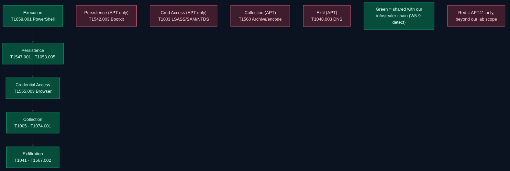

# Week 10 — Learning APT Techniques

## Project: Infostealer Threat Intelligence

**State:** a CTI analysis of a documented APT group's TTPs, mapped to MITRE ATT&CK and
compared with the commodity-infostealer behavior we studied all semester. This week is
**pure open-source intelligence analysis of public reporting** — no execution, no
attribution of our own, no malware. We analyze what established reports (Mandiant, MITRE
ATT&CK, CrowdStrike) already attribute, and connect it to our infostealer theme.

## 1. Objective and relation to the course

The task: analyze the TTPs of an APT group (e.g. APT29 or APT41) and map the observed
techniques to MITRE ATT&CK. We use this to close the project: our infostealer chain
(Weeks 1–9) is *commodity* crime; this week shows how the **same ATT&CK techniques**
appear in a sophisticated, state-linked actor, and how the two worlds connect through the
criminal ecosystem described in the CrowdStrike Global Threat Report.

## 2. Group selected: APT41 — and why

We analyze **APT41** (MITRE ATT&CK **G0096**; also *Wicked Panda*, *Brass Typhoon*,
*BARIUM*; overlaps Winnti, G0044). We considered **APT29** (G0016, *Cozy Bear*, SVR —
espionage, SolarWinds) but chose APT41 because it is **the** well-documented group that
operates as **both** a state-sponsored espionage actor **and** a financially motivated
one — the same dual nature that links APTs to the infostealer/eCrime economy. Its toolkit
includes **browser-credential theft and data staging/exfiltration**, which overlap
directly with our project.

| | APT41 (our pick) | APT29 (alternative) |
|---|---|---|
| ATT&CK ID | G0096 | G0016 |
| Attribution | China-linked; dual espionage + financial crime | Russia-linked (SVR); espionage |
| Why relevant to us | Browser credential theft (BrowserGhost), data theft, financial motive — infostealer-adjacent | Stealthy espionage, supply-chain; less infostealer overlap |

> We report only what public sources attribute. We do not attribute any activity
> ourselves, and an infostealer is not an APT — the comparison is of *techniques*.

## 3. Recommended reading 1 — the Mandiant APT1 report (2013)

The **Mandiant APT1 report** (February 2013) is the landmark that made "APT" a public
term. It attributed a large body of cyber-espionage to **APT1**, assessed as China's
**PLA Unit 61398**, and — more important for us — established the **method** of modern
CTI:

- It described the actor through a repeatable **attack lifecycle** (initial compromise →
  establish foothold → escalate privileges → internal recon → move laterally → maintain
  presence → complete mission), the same stage-thinking as the Cyber Kill Chain we used
  in Week 4.
- It published **indicators and TTPs**, not just a narrative — showing that intelligence
  becomes actionable when it is tied to observable behavior, exactly the discipline we
  applied in Weeks 2–3 (sourced IOCs, roles, dates).

APT1 itself was espionage, not an infostealer operator. We use the report as the
**methodological template** for how to document an adversary — the format our whole
project has imitated.

## 4. Recommended reading 2 — CrowdStrike Global Threat Report

The **CrowdStrike Global Threat Report (GTR)** tracks the eCrime ecosystem and is where
the APT world and the infostealer world meet. Its recurring themes connect directly to
our project:

- **"Logging in, not breaking in."** A large and growing share of intrusions begin with
  **valid stolen credentials** rather than an exploit — and **infostealers are the main
  supplier of those credentials**. The browser passwords and session cookies our project
  studied are the raw material.
- **Access brokers.** A criminal market resells access obtained from stealer logs. An
  infostealer infection on one laptop becomes **initial access** sold to a ransomware
  crew or, in some cases, leveraged by state-linked actors.
- **Cookie/session theft defeating MFA.** Stolen session cookies (our T1539) let
  attackers bypass multi-factor authentication — one reason infostealers remain valuable.

> The exact figures and the current edition/number of the GTR change each year; cite the
> specific edition you use and verify its numbers, as we did for IOCs in Week 3.

This is the key insight of Week 10: **the commodity infostealer we studied is the front
door of the ecosystem the GTR describes**, feeding both eCrime and, at times, APT
operations.

## 5. APT41 TTPs mapped to ATT&CK (and to our chain)

Techniques below are from APT41's MITRE ATT&CK profile (G0096). The right column shows
where each one appeared in our own infostealer work.

| Tactic | APT41 technique (ATT&CK) | In our project |
|---|---|---|
| Execution | **T1059.001** PowerShell (to deploy malware) | Weeks 6–9 (our execution stage) |
| Persistence | **T1547.001** Registry Run Keys (Cobalt Strike persistence) | Week 8 plan, Week 9 atomic |
| Persistence | **T1053.005** Scheduled Task (DEADEYE, campaign C0017) | Week 8 plan, Week 9 atomic |
| Persistence | **T1542.003** Bootkit (MBR bootkits) | *APT-only* — beyond commodity stealers |
| Credential Access | **T1555.003** Credentials from Web Browsers (BrowserGhost) | **Core of our project** (W1, W5 H2, W9) |
| Credential Access | **T1003.001/.002/.003** LSASS / SAM / NTDS | *APT-only* — we excluded in Week 9 |
| Collection | **T1005** Data from Local System; **T1074.001** Local Data Staging | Week 8 plan (staging) |
| Collection | **T1560.001/.003** Archive via utility / custom (RAR, hex-encode PII) | *APT refinement* of our exfil stage |
| Exfiltration | **T1041** Exfil over C2 (Cloudflare) | Week 8 plan (primary exfil) |
| Exfiltration | **T1567.002** Exfil to Cloud Storage (OneDrive) | Week 8 plan (alternative exfil) |
| Exfiltration | **T1048.003** Exfil over unencrypted non-C2 (DNS) | *APT variation* |

## 6. Comparison: commodity infostealer vs. APT41 vs. our emulation plan

| Dimension | Commodity infostealer | APT41 | Our Week 8 plan |
|---|---|---|---|
| Goal | Grab-and-sell credentials/data | Espionage **and** profit | Demonstrate detection |
| Persistence | Often none (smash-and-grab) | Deep (run keys, tasks, bootkit) | Run key / task (benign) |
| Credential access | Browser stores | Browser **+** LSASS/SAM/NTDS | Browser decoy only |
| Lateral movement | Rare | Extensive | Out of scope |
| Exfiltration | Single channel | Multiple (C2, cloud, DNS) | C2 to team endpoint |
| Our detection reach | Good (W5–9) | Partial (shared techniques) | — |

**What this tells a defender:** the *entry techniques* are shared. The PowerShell
execution, Run-key/scheduled-task persistence, and browser-credential access we can
already detect (Weeks 5–9) catch the **early stages** of an APT41-style intrusion too.
Where APT41 diverges — LSASS dumping, lateral movement, bootkits, multi-channel exfil —
is where our coverage ends and enterprise EDR/network monitoring would be needed.

## 7. Defensive takeaways

- The detections we built for a commodity infostealer are **not wasted** against
  sophisticated actors: T1059.001, T1547.001, T1053.005 and T1555.003 are used by both.
- The infostealer is the **supply chain** for the credential-driven intrusions the GTR
  describes; detecting it early prevents the access-broker hand-off.
- Session-cookie theft (T1539) bypasses MFA, so detection — not just prevention —
  matters, which is the whole premise of this threat-hunting course.

## 8. Limitations

- This is analysis of **public reporting**; we attribute nothing ourselves, and TTP-based
  attribution is itself contested (groups copy each other's tools).
- An infostealer is a malware class, not an actor; APT41 is an actor. The comparison is of
  **techniques**, to show overlap — not a claim that they are the same.
- APT-only techniques (bootkits, LSASS, lateral movement) are outside our lab scope and
  were not emulated.
- GTR statistics and edition numbers change; verify the specific report cited.

## 9. References

- Mandiant, *APT1: Exposing One of China's Cyber Espionage Units* (2013) —
  <https://www.mandiant.com/resources/reports/apt1-exposing-one-chinas-cyber-espionage-units>
  (PLA Unit 61398; attack-lifecycle method).
- CrowdStrike, *Global Threat Report* — <https://www.crowdstrike.com/global-threat-report/>
  (access brokers, infostealer-driven initial access, "logging in not breaking in").
- MITRE ATT&CK, **APT41 (G0096)** — <https://attack.mitre.org/groups/G0096/>; campaign
  **C0017** — <https://attack.mitre.org/campaigns/C0017/>.
- MITRE ATT&CK, **APT29 (G0016)** — <https://attack.mitre.org/groups/G0016/> (alternative).
- Google/Mandiant, *APT41: A Dual Espionage and Cyber Crime Operation* (2019).
- Internal: Weeks 1–9 (glossary, IOCs/MISP, Kill Chain, hunting, ATT&CK, CAR, emulation
  plan, atomic tests).
- Course AI-use statement: see main [README](../README.md).
